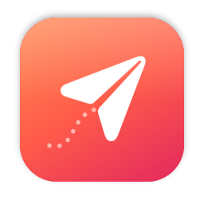
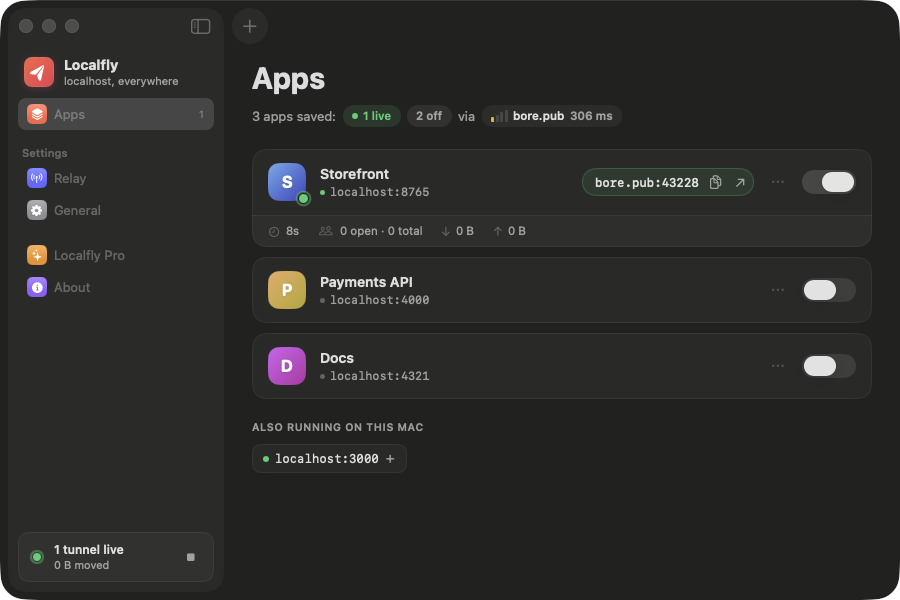

<p align="center">
  
</p>

<h1 align="center">Localfly</h1>

<p align="center">
  Your localhost, on the internet.<br>
  A free, open-source Mac menu bar app that gives any app on your Mac a public link.
</p>

<p align="center">
  <a href="https://github.com/raqibnur/localfly/releases/latest/download/Localfly.dmg"><b>Download for Mac</b></a> ·
  <a href="https://raqibnur.github.io/localfly/">Website</a> ·
  <a href="docs/self-hosting.md">Self-hosting</a> ·
  <a href="https://github.com/sponsors/raqibnur">Sponsor</a>
</p>

<p align="center">
  
</p>

## What it does

Save an app by its port, flip the switch, and share the address. Test your site on your phone, show work to a client, or receive webhooks, all without deploying anything.

- **Menu bar first**: every app, its status and a copy button, one click away. Closing the window keeps tunnels running.
- **Knows what's running**: a dot shows whether your dev server is up, and Localfly won't open a tunnel to an empty port.
- **Spots dev servers**: common ports like `:3000` and `:5173` show up ready to add.
- **Live traffic**: uptime, connections and bytes in and out for each tunnel.
- **Reconnects by itself** after Wi-Fi drops or sleep, and asks for the same address back.
- **HTTPS on your own domain** when you [run your own relay](docs/self-hosting.md).
- **Private by default**: nothing is exposed until you switch it on. No account and no analytics. The relay secret is kept in your keychain.

Requires macOS 13 or later, on Apple silicon or Intel.

## How it works

Localfly speaks the [bore](https://github.com/ekzhang/bore) tunnel protocol. Your Mac opens an outgoing connection to a relay server. When someone visits the public address, the relay passes the connection through to your machine. Nothing on your router or firewall changes.

By default it uses **bore.pub**, a free public relay. Addresses look like `http://bore.pub:43228` and change each time a tunnel opens. For stable `https://` addresses on your own domain, set up your own relay with [the self-hosting guide](docs/self-hosting.md). It takes one `docker compose up` on a $5 server.

> **Heads-up:** anyone with a tunnel's address can reach that app while it's on. Only share what you mean to share.

## Localfly Pro?

Localfly is free and stays free. I'm considering a hosted Pro version: instant `https://yourapp.localfly.dev` addresses with no server to run, custom domains, a request inspector and protected links. If you'd use it, [join the waitlist](https://raqibnur.github.io/localfly/#pro). It only gets built if enough people want it.

## Build from source

```bash
brew install xcodegen
git clone https://github.com/raqibnur/localfly.git && cd localfly
xcodegen generate && open Localfly.xcodeproj
```

```
LocalflyCore/   Swift package: the tunnel engine (bore protocol over Network.framework), no UI
App/            SwiftUI app: menu bar panel and main window, a thin layer over TunnelManager
deploy/         Relay for self-hosting: bore server + Caddy (docker compose)
site/           Website (GitHub Pages)
scripts/        build.sh (.app + .dmg), notarize.sh, make-icon.swift
```

Tests run against a real bore server on 127.0.0.1 and are skipped when `bore` isn't installed:

```bash
cargo install bore-cli
swift test --package-path LocalflyCore
```

### Release

```bash
scripts/build.sh   # universal, ad-hoc signed: dist/Localfly.app + dist/Localfly.dmg
```

```bash
DEVELOPER_ID="Developer ID Application: Name (TEAMID)" NOTARY_PROFILE=localfly scripts/notarize.sh
```

Or let Xcode handle signing with the Apple ID signed in under Xcode → Settings → Accounts. Xcode creates a cloud-managed Developer ID certificate, notarizes and staples the app, and you need no passwords:

```bash
TEAM_ID=YOURTEAMID scripts/notarize-xcode.sh
```

`notarize.sh` signs, notarizes and staples the DMG. It also accepts `APPLE_ID`, `APPLE_TEAM_ID` and `APPLE_APP_PASSWORD` in place of a keychain profile. Upload `dist/Localfly.dmg` to a GitHub release tagged `vX.Y.Z`, and the app tells users that an update is available.

## Contributing

Issues and pull requests are welcome. See [CONTRIBUTING.md](CONTRIBUTING.md). Report security problems privately as described in [SECURITY.md](SECURITY.md).

## Support

If Localfly saves you time, [sponsoring on GitHub](https://github.com/sponsors/raqibnur) helps keep it maintained.

## License

[MIT](LICENSE) © 2026 Raqib Nur. Localfly is compatible with bore by Eric Zhang (MIT), and its license notice appears in the app's About page.
